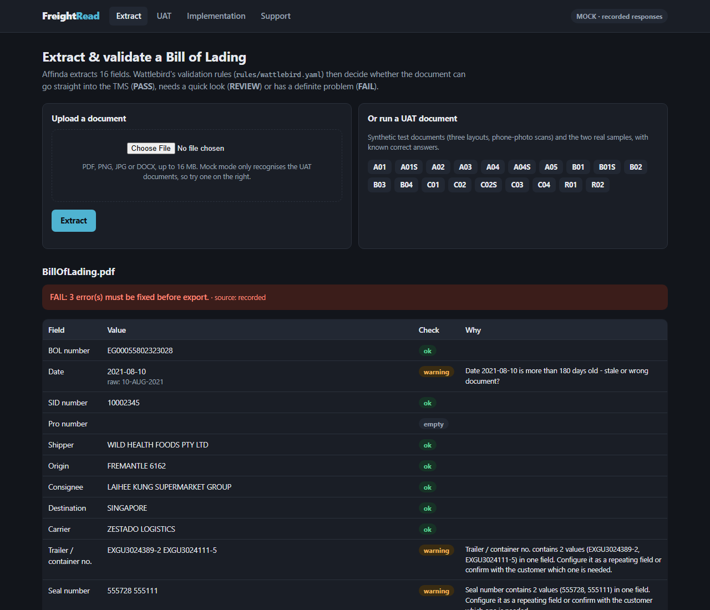
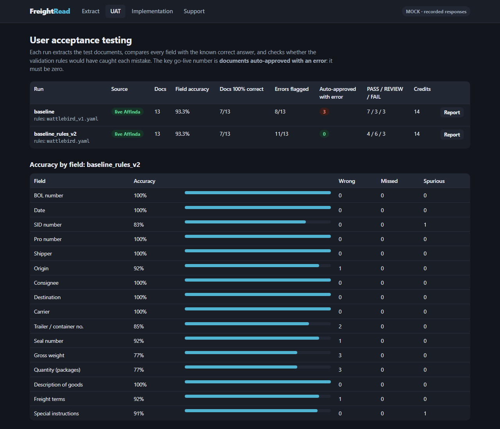
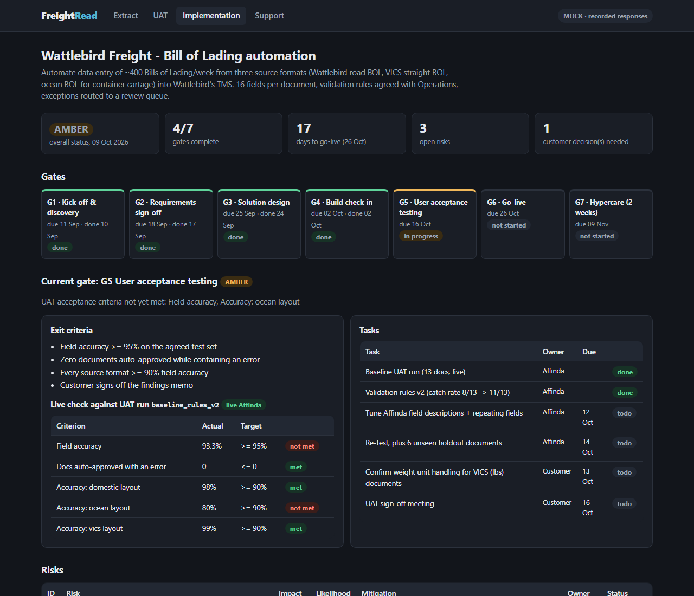
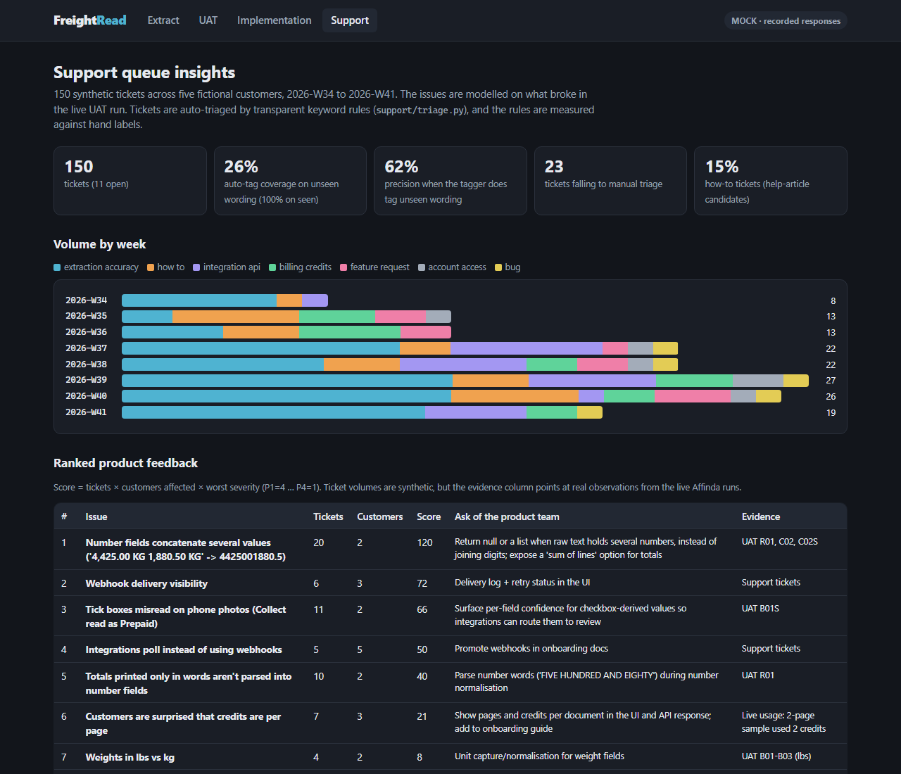

# FreightRead: implementation & support toolkit for Affinda Extract

A worked example of taking a document-AI customer from **sample documents to a tested, tracked, supportable go-live**,
built on the [Affinda](https://affinda.com) Extract API.

The customer is **Wattlebird Freight** (fictional), an Australian road carrier that keys ~400 Bills of Lading a week into
its TMS by hand. This repo covers the four parts of that job:

| | What it does | Where |
|---|---|---|
| **1. Configure & validate** | Affinda extracts 16 BOL fields. Customer-specific rules in YAML route each document to PASS / REVIEW / FAIL | `freightread/`, `rules/` |
| **2. Test (UAT)** | 19 test documents with known answers, scored field by field against live Affinda output | `uat/` |
| **3. Run the implementation** | Gate tracker whose UAT gate reads the real test results, plus a generated weekly status email | `tracker/` |
| **4. Support & feedback** | Synthetic support queue, measurable auto-triage, product feedback ranked and tied to evidence | `support/` |

Write-ups: **[findings memo](docs/findings_memo.md)** · [implementation plan](docs/implementation_plan.md) ·
[Affinda config tuning](docs/config_tuning.md) · [demo script](docs/demo_script.md)



## Results from the live Affinda run

13 documents, **14 credits**, every response recorded in `uat/recordings/`:

| | Rules v1 (as first agreed) | Rules v2 (after UAT) |
|---|---|---|
| Field accuracy (194 fields) | 93.3% | 93.3% |
| Extraction errors flagged by validation | 8 / 13 | 11 / 13 |
| **Documents auto-approved with an error** | **3** | **0** |
| Straight-through (PASS) documents | 7 | 4 |

By format: Wattlebird road BOL 98% · VICS BOL 99% · **ocean BOL 80%** (totals spread across container lines).

Most important findings ([memo](docs/findings_memo.md)):
- Two container weights `4,425.00 KG 1,880.50 KG` came back as **4,425,001,880.5 kg**: digits merged into one number.
- On a phone photo, the **Collect** box was read as **Prepaid**, and the v1 rules let it through to billing.
- Per-field `confidence` is `null` on Extract document types, so validation rules carry the auto-approval decision.
- Honest caveat: v2 was tuned on the same documents it's scored on. Six holdout documents are reserved for the next run.



## Quick start

```bash
pip install -r requirements.txt
python app.py
```

Open http://localhost:5000. Out of the box it runs in **mock mode**, which replays the recorded live Affinda
responses, so it's free and needs no API key. To extract your own documents, copy `.env.example` to `.env`, add an
Affinda API key, workspace and document type, and set `EXTRACTOR_MODE=live` (1 credit per page).

| Command | What it does |
|---|---|
| `python -m uat.generate_documents` | Rebuild the synthetic BOLs + ground truth (seeded, reproducible) |
| `python -m uat.run_uat --label NAME --mode live --only A01,R02` | Live UAT run (uses credits); partial runs merge into one report |
| `python -m uat.run_uat --rescore baseline --label NAME --rules rules/X.yaml` | Re-score saved responses with different rules (0 credits) |
| `python -m tracker.tracker` | Print the weekly customer status update |
| `python -m support.generate_tickets && python -m support.insights` | Rebuild the ticket queue and print the analysis |
| `python -m pytest` | 36 tests (validation on real recorded responses, scoring, tracker, triage, app) |

## How it works

```
document ──► Affinda Extract API ──► normalise (raw + parsed per field) ──► validation rules (YAML)
              (live, or recorded                                                 │
               response in mock mode)                         PASS → TMS · REVIEW → review queue · FAIL → fix
```

- **Rules are configuration, not code** (`rules/wattlebird.yaml`): required fields, formats, ranges, date windows,
  allowed values with synonyms, "several numbers in the source text", "several IDs in one field", printed-boilerplate
  detection, review-if-scanned, cross-field checks, and an ISO 6346 container check digit (built, off by default).
- **raw vs parsed:** Affinda returns the text as printed and its normalised value. Comparing the two is how merged
  numbers and unparseable values get caught.
- **UAT scoring** uses field-appropriate matching (identifiers exact, numbers within 0.5%, names allow the address that
  follows them), and reports what matters for go-live: errors that validation *didn't* catch.
- **Mock mode** replays real recorded responses and labels anything simulated, so simulated numbers can't be passed
  off as Affinda accuracy.

## Implementation tracker & support



The tracker's UAT gate reads `uat/results/*/summary.json`, so it's amber because the real numbers miss the 95% target,
not because someone typed "amber".



The support queue is synthetic, but the issues are modelled on what broke in the live run. The keyword triage scores
**100% on wording it was written for and 16% on new wording**, and both numbers are shown. Unmatched tickets fall back to a
person rather than getting a wrong tag.

## What's real and what isn't

- **Real:** every Affinda response in `uat/recordings/` (live API, October 2026), the two sample BOLs in `samples/`, and
  all accuracy numbers above.
- **Synthetic:** Wattlebird Freight and every other company, the 17 generated BOLs, the support tickets, and the project dates.
  Container numbers are illustrative and don't carry valid check digits.

## Project layout

```
app.py                  Flask app: Extract · UAT · Implementation · Support
freightread/            Affinda client, normaliser, validation engine, UAT scorer, mock extractor
rules/                  wattlebird.yaml (v2, current) and wattlebird_v1.yaml (as first agreed)
uat/                    document generator, documents, ground truth, recordings, runner, results
tracker/                project YAML + RAG/status-update logic
support/                ticket generator, triage rules, insights
docs/                   findings memo, implementation plan, config tuning, demo script, screenshots
samples/                the two real sample BOLs
tests/
```

Evolved from [FreightRead](https://github.com/Fakrul-chowdhury/freightread), my earlier Affinda BOL extractor.
